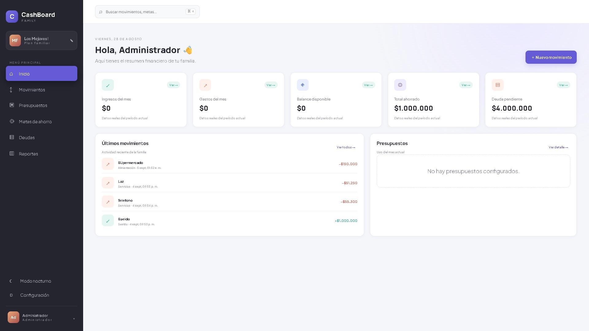

# CashBoard Family

Dashboard financiero familiar full stack para administrar ingresos, gastos, presupuestos, metas de ahorro y deudas. Diseñado como proyecto profesional de portafolio con una interfaz responsive y datos demo en CLP.

## Vista previa



Captura de la aplicación en ejecución con el resumen financiero, últimos movimientos y panel de presupuestos.

## Funcionalidades implementadas

- Inicio de sesión con JWT y roles Admin / Family.
- Dashboard de ingresos, gastos, ahorro y deuda en CLP.
- Gestión de movimientos, presupuestos, metas de ahorro y deudas.
- Administración de usuarios y nombre del plan familiar.
- Frontend conectado a la API mediante HttpClient e interceptor JWT.
- Filtros de movimientos, modo nocturno e interfaz responsive.

## Stack

- Angular 20 standalone + Signals + SCSS
- ASP.NET Core 10 Minimal API, JWT y Swagger
- Entity Framework Core + SQLite local / PostgreSQL 16 en producción
- Docker Compose

## Ejecutar la aplicación

```bash
cd frontend
npm install
npm start
```

`npm start` levanta automáticamente la API y Angular en la misma terminal, y abre CashBoard en `http://localhost:4300`. Para detener todo presiona `Ctrl+C`.

## MVP funcional local

También puedes iniciar cada servicio por separado para depuración. API (requiere .NET SDK 10):

```bash
cd backend/CashBoard.Api
dotnet run
```

Frontend Angular:

```bash
cd frontend
npm start
```

Las cuentas de desarrollo se definen en `backend/CashBoard.Api/Data/DemoSeeder.cs`; revisa ese archivo para la configuración local. La API crea automáticamente `cashboard-demo.db` sin registros financieros precargados. La base SQLite local está ignorada por Git.

El administrador puede gestionar usuarios desde **Configuración**: crear cuentas, cambiar datos o roles y eliminar usuarios. La cuenta Familia no ve Configuración y todas sus operaciones de escritura son rechazadas por la API.

Desde la misma pantalla el administrador puede personalizar el nombre del plan familiar. El modo nocturno y el menú de cierre de sesión están disponibles en la barra lateral.

## Ejecutar API y base de datos

Con Docker instalado:

```bash
docker compose up --build
```

Opcionalmente copia `.env.example` como `.env` y reemplaza sus valores. El archivo `.env` está ignorado por Git y nunca debe publicarse.

API: `http://localhost:8080` · Swagger: `http://localhost:8080/swagger` · PostgreSQL: puerto `5432`.

Para desarrollo local usa .NET SDK 10. SQLite se crea y carga automáticamente; Docker utiliza PostgreSQL mediante `DatabaseProvider=Postgres`.

## Arquitectura y permisos

La separación `frontend` / `backend` mantiene la UI desacoplada de la API REST. Todas las entidades se filtran por el `FamilyId` incorporado en el JWT. `Admin` dispone de CRUD completo; `Family` puede consultar dashboard y módulos, pero la API rechaza sus mutaciones con HTTP 403. Antes de producción deben configurarse secretos por variables de entorno y refresh tokens.

## API principal

| Método | Ruta | Función |
|---|---|---|
| POST | `/api/auth/login` | Autenticación y JWT |
| GET | `/api/dashboard/summary` | Métricas del mes |
| GET/POST | `/api/transactions` | Movimientos |
| DELETE | `/api/transactions/{id}` | Eliminar un movimiento propio de la familia |
| GET | `/api/categories` | Categorías familiares |
| GET | `/api/budgets/current` | Presupuestos vigentes |
| GET/POST | `/api/savings-goals` | Metas de ahorro |
| GET | `/api/debts` | Deudas |

## Próximas mejoras

- Revisar migraciones y datos de demostración reproducibles.
- Fortalecer validación de entradas, autenticación y manejo de errores.
- Añadir pruebas de aislamiento entre familias y permisos de escritura.
- Incorporar exportación PDF/Excel, filtros paginados y CI/CD.
- Preparar un despliegue público con secretos y persistencia configurados.

No uses las credenciales ni la clave JWT de desarrollo en producción.

## Reportar problemas y colaborar

Abre un issue con los pasos para reproducir el problema, el resultado esperado y el resultado obtenido. Incluye navegador o versión del entorno cuando sea relevante y evita publicar datos personales o credenciales. Para proponer una mejora, explica el caso de uso y el alcance antes de enviar un pull request.
